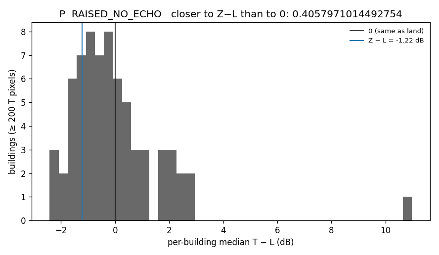
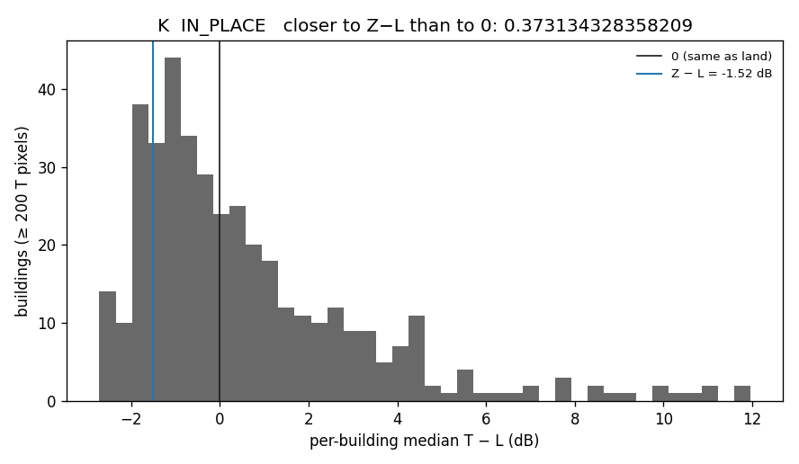
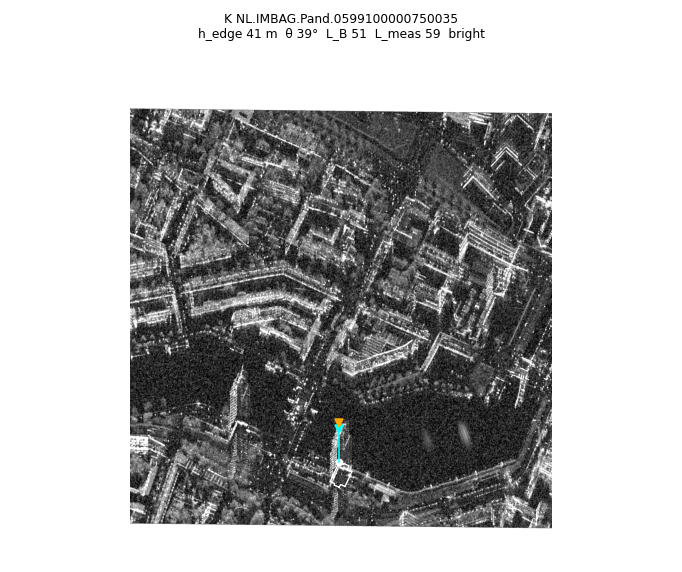
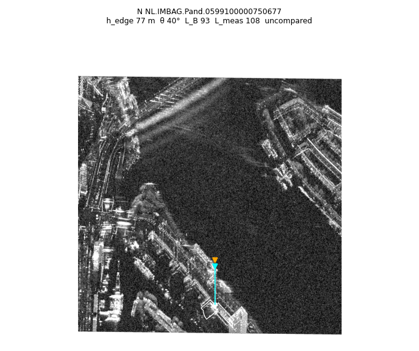
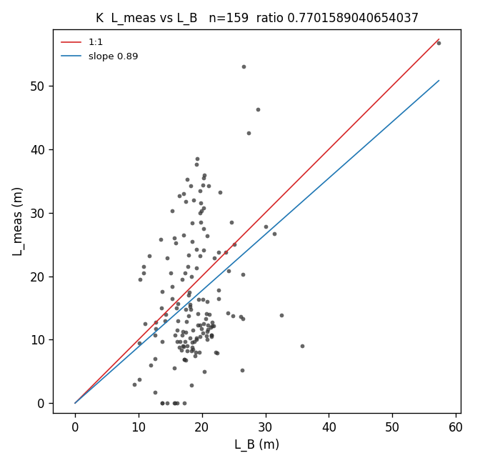
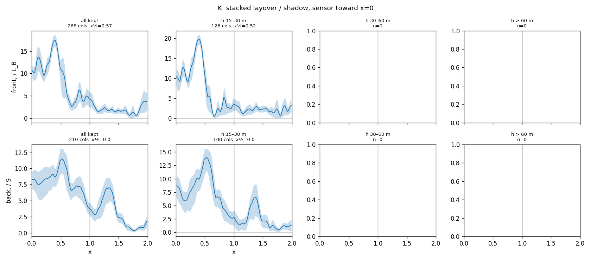
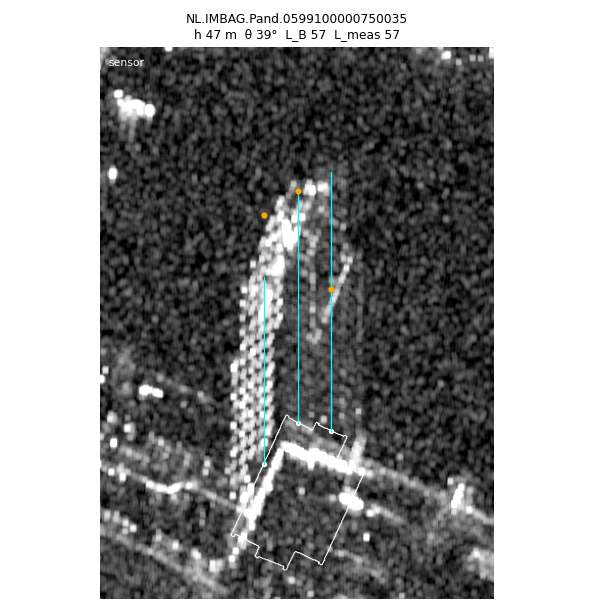

# Roofs stay on the footprint

[RULE_CHECK.md](RULE_CHECK.md) scored two placement rules on the port strip and passed neither. Layover was bright enough. Shadow was not dark enough. On the footprints, rule A (SRTM closest-approach) still sat too close to the sensor, and rule B (the surface stays on its map column) was the closer of the two. The bright pixels sat on the lidar footprint. This note is the decision that check could not make: which rule the roof follows, and how far the layover in front of the wall actually reaches.

No third placement rule. Dataset v2 was not modified. No tiles were built. `image_space.py` was not changed.

| rule | where a surface is written |
|---|---|
| A, lean | `image_space.project_grid`. Closest-approach range onto SRTM. |
| B, in place | `image_space.own_range_grid`. The surface stays on its own map column. Shadow is the geometric shadow. |

| strip | id | role | sensor |
|---|---|---|---|
| P | `20190822074237_20190822074521` | port. A-full and B-full reused from `sar/output/rule_check/` | row 0. Look 180.18°, platform 1614 m |
| K | `20190823072627_20190823072925` | Kop van Zuid. A-full, B-full, B-bldg computed here | **south edge.** Catalog look 0.46° is the backwards flag. Alpha is higher at the north edge |
| N | `20190823073526_20190823073827` | not a v2 strip. North bank, from the south. Part 1b only | south edge, same sense as K |

HH is MAG-POL band 1, already dB. Range is the short axis (~3k rows, ~760 m). Along-track is the long axis. For K and N, canonical row 0 is the sensor, so `canonical = (height − 1) − file_row`, and the crops are flipped. Near is toward the sensor. Padding, `r`, `alpha`, SRTM `r_ref`, `nan_margin=400`, holes under 100 m², and the water fill are the v3 pipeline. Local ground is the 5th percentile of the DSM within 50 m. There is no DTM. `s` is SRTM GL1 ellipsoidal minus that ground.

Code: [`sar/decide.py`](sar/decide.py), [`sar/decide_lay.py`](sar/decide_lay.py). Numbers and crops: [`sar/output/decide/`](sar/output/decide). The coverage GeoTIFFs and the prep arrays are not in the repo.

## The footprint test

T, Z, W, and L are pixel sets, not new classes.

| set | definition |
|---|---|
| T | inside a 3DBAG footprint eroded by 2 m, at least `6 m + max(0, s) / tan θ` behind that building’s near wall, A-full coverage < 0.5, B-full ≥ 0.5, known in both, HH finite, not water |
| Z | outside footprints, and every pixel within 2 m is A-full < 0.5 and B-full < 0.5, known, not water |
| W | open water more than 30 m from shore |
| L | both labels nominal, outside footprints, not water |

T is the pixel the two rules disagree on: A calls it shadow, B calls it nominal. Z is the no-echo they agree on. The decision is the whole strip, not a range third.

| if | call |
|---|---|
| Z−L ≤ −1.5 and \|T−Z\| ≤ 0.5 | LEAN. T is the no-echo population, so the footprint belongs at the SRTM range |
| Z−L ≤ −1.5 and T−L ≥ −0.5 | IN PLACE. The no-echo is dark, and the footprint is not |
| Z−L > −1.5 | RAISED_NO_ECHO. The floor beside buildings is not a shadow. Do not force a verdict from the inequality |
| T−L in (−1.0, −0.5) with a dark Z | BETWEEN. The two calls do not overlap. This did not occur |

## 1. Port strip — RAISED_NO_ECHO

Z−L = **−1.22 dB**, T−L = **−0.42**, T−Z = **+0.80**, W−L = **−1.86**. Open water is a dark floor. Agreed no-echo next to buildings is only 1.22 dB below land, so the gate does not fire. T is 0.80 dB above that no-echo level. It is not Z.

Buildings with any T: 202. With at least 200 T pixels: 69.

Median HH in dB. The second number is minus L.

| set | near | middle | far | all |
|---|---|---|---|---|
| T | −13.69 (242811, −0.46) | −13.99 (236516, −0.68) | −13.73 (45334, −0.04) | −13.83 (524661, −0.42) |
| Z | −14.75 (78234, −1.52) | −14.81 (267279, −1.50) | −14.37 (257290, −0.68) | −14.63 (602803, −1.22) |
| W | −15.21 (3.14e6, −1.98) | −15.31 (4.71e6, −2.00) | −15.25 (2.51e6, −1.56) | −15.27 (1.04e7, −1.86) |
| L | −13.23 (1.06e7) | −13.31 (1.83e7) | −13.69 (1.43e7) | −13.41 (4.33e7) |

The near third alone would be IN PLACE (Z−L −1.52, T−L −0.46). The far third is where Z is raised (−0.68). The rule uses the whole strip.

Per building, at least 200 T pixels. “Closer to Z” means closer to Z−L (−1.22) than to 0.

| bin | n | closer to Z | closer to 0 | median T−L |
|---|---:|---:|---:|---:|
| all | 69 | 0.41 | 0.59 | −0.36 |
| 10–20 m | 36 | 0.50 | 0.50 | −0.59 |
| 20–40 m | 15 | 0.40 | 0.60 | −0.24 |
| > 40 m | 4 | 0.25 | 0.75 | +0.28 |

The eight largest T footprints run from T−L −1.52 to +0.14. The biggest, `0599100000380290` (n = 49724), is −0.06: land level inside the footprint, bright return toward the sensor. Crops are `sar/output/decide/P/crop_*.png`, sensor at the top, footprint white, T outlined magenta, nearby Z outlined blue.

Read: LEAN is not earned, because the no-echo beside buildings is raised relative to open water. The disputed roof pixels are not that no-echo population. They sit near land, and the four buildings over 40 m sit above land. That is roofs in place. It is not rule A.

## 2. Kop van Zuid — IN PLACE

Z−L = **−1.52 dB**, T−L = **−0.04**, T−Z = **+1.48**, W−L = **−2.06**. Both arms of IN PLACE hold. T is 1.48 dB brighter than the agreed no-echo.

Buildings with any T: 857. With at least 200 T pixels: 402.

| set | near | middle | far | all |
|---|---|---|---|---|
| T | −13.07 (717093, −0.20) | −13.23 (745045, −0.22) | −12.73 (555400, +0.34) | −13.03 (2.02e6, −0.04) |
| Z | −14.39 (105877, −1.52) | −14.69 (316672, −1.68) | −14.41 (426917, −1.34) | −14.51 (849466, −1.52) |
| W | −15.01 (3.54e6, −2.14) | −14.99 (2.77e6, −1.98) | −15.19 (1.93e6, −2.12) | −15.05 (8.25e6, −2.06) |
| L | −12.87 (1.10e7) | −13.01 (1.58e7) | −13.07 (1.13e7) | −12.99 (3.82e7) |

| bin | n | closer to Z | closer to 0 | median T−L |
|---|---:|---:|---:|---:|
| all | 402 | 0.37 | 0.63 | −0.17 |
| 10–20 m | 259 | 0.39 | 0.61 | −0.32 |
| 20–40 m | 53 | 0.51 | 0.49 | −0.94 |
| > 40 m | 21 | 0.24 | 0.76 | +0.64 |

The 20–40 m bin is the exception (median −0.94, about half closer to Z−L). It is not the LEAN test, which would need T within 0.5 dB of Z, so T−L ≤ −1.0. Buildings over 40 m are brighter than land (median +0.64, 76% closer to 0).

Largest crops, from [`K/crops.json`](sar/output/decide/K/crops.json): `0606100000010427` T−L +3.14 (n = 61262), `0599100100017701` +3.60 (n = 32894, h ≈ 53 m). Two of the eight are near Z (`0599100000633369` −1.48, `0599100000435130` −1.90). They are the minority.

**K is the strip that decides the placement.** Z is actually dark there, and the disputed footprint is land. P does not contradict it. P only fails to reach the dark-Z bar.

## 3. Riverbank towers

SpaceNet 6 Figure 2 is three tall returns on the north bank, imaged from the south, streaking out over the water toward the sensor, with the roof edge at the tip. The test does not use names. Wilhelminapier, De Rotterdam, New Orleans, and Montevideo are south bank.

Reference point, north bank opposite Wilhelminapier: UTM (602359.1 E, 5752163.5 N), 51.9108°N, 4.4881°E. Of the 20 v2 strips, one contains it: `20190823083559_20190823083940`. That MAG-POL is not on disk. N covers the point and looks the same way (sensor at the south), so N was searched instead.

A building qualifies if 3DBAG roof−ground is over 40 m and open water lies within 150 m of the sensor-facing wall, on the sensor side of that wall.

| strip | buildings > 40 m | water ≤ 150 m toward the sensor |
|---|---:|---:|
| P | 3 | 0 |
| K | 32 | 4 |
| N | 38 | 5 |

None of the nine stands on that quay. The two eastern K hits are south bank. The three N-only hits are 300–460 m north of the reference, with a nearer water body to their south. P has no qualifying building.

`L_B = g − √(g² − 2 H h + h²)` with `h = h_edge`, the 90th percentile of AHN within 3 m behind the near wall, minus local ground. `H` and `g` are slant·cos α and slant·sin α at the ground point. `L_meas` here is the fade to open-water median + 1.5 dB: a 9 px mean of linear power, gaps up to 8 m. Cyan on the crops is `L_B`, orange is `L_meas`. Where a 4 m profile along the same column disagrees with `L_meas`, the profile is the one below.

| strip | pand | where | h_edge | θ | L_B | L_meas | what the column does | footprint | T−L |
|---|---|---|---:|---:|---:|---:|---|---|---|
| K | 0599100000750603 | 2.6 km west | 36 | 40° | 43 | 66 | bright core ends ~40 m, water by 40 m. The +1.5 dB fade runs to 66 m on speckle | bright | −1.18 |
| K | 0599100000750035 | 2.0 km west | 41 | 39° | 51 | 59 | +7 dB spike at 40–48 m, water by 60 m | bright | none |
| K | 0599100000750601 | south bank | 40 (bag 90) | 25° | 89 | 0 | nodata for the whole 83 m in front of the wall | dark (−1.8) | −1.82 |
| K | 0599100100010084 | south bank | 74 | 29° | 143 | 91 | dotted, still bright at 88 m, then the swath ends | bright (+2.6) | +0.64 |
| N | 0750603, 0750035 | same two buildings | 34, 48 | 27°, 26° | 69, 102 | 9, 0 | water in front is nodata. Not a second measurement | — | — |
| N | 0599100000700033 | 300 m north | 4.6 (bag 68) | 38° | 6 | 79 | bright to ~76 m. That is bag height / tan θ, not the 5 m lip | bright behind the lip | n = 21 |
| N | 0599100000750677 | 376 m north | 77 | 40° | 93 | 108 | continuous bright return, water by ~100 m | roof bright just behind the wall | +0.80 |
| N | 0599100000612035 | strip edge, 463 m north | none (bag 75) | 42° | — | 0 | false zero. 16 m of nodata, then −6 to +4 dB until ~76 m | off the edge | none |

What the streaks are:

- **0750603 and 0750035.** Real layover of a standing building. The bright core ends within a few metres of `L_B`. The footprint is land-bright, not empty. N’s short `L_meas` on the same two is the swath edge.
- **0599100100010084.** Real, south bank. This is the pand [RULE_CHECK.md](RULE_CHECK.md) drew with a 133 m cyan roof shift and a bright return inside the white outline. Both are still true. There is also a dotted streak toward the sensor, not a solid smear, out to the last valid pixel at ~90 m. `L_B` = 143 m is past the swath, so the tip was not observed. Roof median is +2.6 dB versus land.
- **0750601.** Not a measurement. Bag height 90 m, AHN edge 40 m, and every pixel in front of the wall is nodata. Same building the earlier tower crop could not use. Do not call it a ghost.
- **0750677.** The clean geometry, 376 m north of the quay rather than on it. Roof bright in place (T−L +0.80). Streak fades to water at ~95 m against `L_B` 93 m. Real 2019 building. Open water is 146 m out, so the streak dies at the near shore, not across the Nieuwe Maas.
- **0700033.** Real mass, wrong edge. The sensor-facing lip is 4.6 m, so `L_B` is 6 m, but the return runs ~76 m, which matches the 68 m bag height at 38°. The formula was fed a podium.
- **0612035.** The automatic tag `no_2019_mass_and_no_streak` is wrong. The wall is 1 m from the north edge, the first 16 m is nodata, and the 8 m gap rule then returns zero. From 16 m to ~76 m the column is bright and then drops to water. A standing building clipped by the strip, not a ghost, and not the quay.

No qualifying building is a ghost of something that was not there in 2019. The north-quay trio is not in this set.

## 4. How far the layover reaches

Both rules paint the layover in front of the wall. This section does not choose A or B. It checks `L_B`.

This is not the layover-length table in [RULE_CHECK.md](RULE_CHECK.md) §7. That one kept 16 port columns, used `h′ = h − s`, and got a median ratio 0.36. The column cut and the measured length are different here, and K is included. Do not average the two.

A column is kept only if `h_edge` ≥ 8 m, `L_B` ≥ 8 m, the profile fits in the image, and no other footprint and no undilated clutter (nDSM > 3 m outside footprints, not the 30 m dilation) lies between 1 m and 1.3·`L_B` in front of the wall. That drops almost every tall front in the city. The kept sample is mostly 15–30 m walls. The filter is for the measurement. It is not a label rule.

`L_meas` is the farthest offset where the 9 px mean of linear power, taking the max of the three columns around the brightest within 3 m, stays at least 2× the median power on [1.6, 2.0]·`L_B`, gaps up to 8 m. Zero if the threshold is never met. The stacked profile is linear power, each column divided by that same background, averaged, then written in dB. Half-power x is where the mean linear ratio falls to half its level on x ∈ [0, 0.3]. That is −3 dB of the linear near-wall level, not half of the dB value.

`L_A` is the same formula with `h′ = h_edge − s`. `S = g_back · h / (H_back − h)` is the shadow length used to scale the back profile.

### K

1482 buildings with roof−ground ≥ 15 m. 3895 columns. Dropped: low edge 826, another footprint 1868, clutter 814, off the image 94. Kept **293 columns, 172 buildings**.

| bin | columns | buildings | half-power x |
|---|---:|---:|---:|
| all | 268 | 159 | 0.57 |
| 15–30 m | 126 | 76 | 0.52 |
| 30–60 m | 4 | 2 | not reported (n < 5) |
| > 60 m | 0 | 0 | — |

Back side, scaled by S: recover-x = **0.0** on 210 columns. The first bin is already at the background. There is no dark shadow in the stack. A single tall crop can still look darker on the far side of the footprint. The average does not.

| | |
|---|---|
| n | 159 |
| median L_B | 18.5 m |
| median L_meas | 13.8 m |
| median L_meas / L_B | 0.77 |
| slope through the origin | 0.89 |
| RMS vs 1:1 | 10.0 m |
| fraction L_meas = 0 | 0.044 |
| median L_meas / L_A (n = 156) | 1.14 |

`L_A` is worse than `L_B` on K. The bright length is not tracking the SRTM-minus-ground offset.

The tallest column that survived the filter:

| pand | h_max | L_B | L_meas | ratio |
|---|---:|---:|---:|---:|
| 0599100000750035 | 51.7 m | 57.3 | 56.8 | 0.99 |
| 0599100000750603 | 39.6 | 30.1 | 27.9 | 0.93 |
| 0599100000668297 | 29.4 | 27.3 | 42.6 | 1.56 |
| 0599100000664969 | 29.0 | 32.6 | 13.9 | 0.43 |
| 0599100000648293 | 27.5 | 35.8 | 9.0 | 0.25 |

0750035 is 1:1. It is the same building as the water streak above, on a column that does not cross the water. The roof is bright on the footprint. Cyan `L_B` and orange `L_meas` meet.

### P

194 buildings ≥ 15 m. 765 columns. Dropped: low edge 138, another footprint 417, clutter 139, off the image 33. Kept **38 columns, 26 buildings**. No kept column is over 30 m.

| bin | columns | buildings | half-power x |
|---|---:|---:|---:|
| all | 35 | 25 | 0.42 |
| 15–30 m | 7 | 5 | 0.33 |
| 30–60 and > 60 | 0 | 0 | — |

Back recover-x = 0.0 (33 columns).

Scatter n = 25: median L_B 17.7 m, median L_meas 10.0 m, ratio 0.72, slope 0.66, RMS 10.6 m, fraction zero 0.08. Median L_meas / L_A = 0.89. On this small port sample `L_A` is slightly closer to 1 than `L_B`. It does not reverse K, and n = 25 with nothing over 30 m is the wrong place to prefer `L_A`.

The other v2 strips were not run. Each MAG-POL is about 3.4 GB and the volume did not have room for another one.

## What is settled

Rule B. On K, where Z is actually dark (−1.52 dB, water −2.06), the disputed footprint is land (−0.04) and the buildings over 40 m are brighter than land. On P the floor beside buildings is raised (−1.22 against water −1.86), so the formal call is RAISED_NO_ECHO, and the histogram points the same way: T is not Z. Nothing in either strip supports LEAN. Rule A would have put T on Z.

The layover in front of the wall is real. On the short-building average the bright core ends before the full geometric length (half-power at 0.57 `L_B` on K, 0.42 on P). The 2×-background length tracks `L_B` with slope 0.89 on K (n = 159, RMS 10 m). The one clean ~52 m column is 1:1, and the water-facing towers that can be measured fade at `L_B` with the roof still bright on the footprint. Use `h_edge`, not bag height: 0700033 shows a podium feeding the formula a 5 m wall in front of a 68 m roof. Use `L_B`, not `L_A`.

Stacked shadow is not there. The back profile is at the background in the first bin on both strips. That is the same fact as v2 shadow − nominal ≈ 0 dB and the rule-check shadow gate. A new placement will not make shadow dark. Urban no-echo beside buildings is brighter than open water (raised by about 0.5 dB on K, about 0.6 dB on P).

## Next label

One label set, `inplace-lb`, scored on P and K before any tiles. Do not download more strips first. Do not edit `image_space.py`. Do not overwrite v2.

Write it as follows.

1. **Footprint.** 3DBAG, eroded 2 m, and only the part at least `6 m + max(0, s) / tan θ` behind the near wall: nominal. Not shadow, not layover. This is the T population.
2. **Layover.** From the near-wall foot toward the sensor, length `L_B(h_edge)`. `h_edge` is the 90th percentile of AHN nDSM in the 3 m behind that wall, minus local ground. Skip a column when `h_edge` < 8 m or the square root is not positive. Stop at the next footprint; do not paint through another building. Where two layovers overlap, the larger `L_B` wins. Do not apply the Part 2 isolation cut. That cut was only so the background was empty, and it is why the tall fronts are missing from the scatter.
3. **Shadow.** Geometric `S` from the back wall, away from the sensor, on pixels that are not layover and not footprint. Write it. Do not gate on it.

Score on known, non-water pixels. Do not use the 30 m clutter dilation: [RULE_CHECK.md](RULE_CHECK.md) showed it removes the buildings, which is why that registration kept no windows.

| check | pass | on |
|---|---|---|
| layover − nominal | ≥ +1.5 dB | near and middle, both strips |
| footprint interior − land | ≥ −0.5 dB | whole strip, both strips |
| shadow − nominal | report only | expect about 0 |

Break the footprint number by the same height bins as Part 1. The K 20–40 m bin (median T−L −0.94, n = 53) is the one to look at before tiling. If those footprints are courtyards or the low lip of a taller roof, fix the edge sample. If they are dark roofs, say so. Do not go back to rule A on that bin.

If layover fails only because the dim tail past ~0.6 `L_B` pulls the median down, rescore **once** with the label cut at 0.6 `L_B`. Half-power on K was 0.57. Do not invent a third placement.

Tile only if both pass lines hold on P and K. Same tile recipe as v2: sensor at the top, float16 dB, incidence in its own key, train-only norm. New `label_version`. Leave v2 where it is.

Not next: the remaining MAG-POLs, a SNAP rerun, or a hunt for the Figure 2 quay. The one v2 strip that contains the north-bank point can wait until `inplace-lb` has a number.
