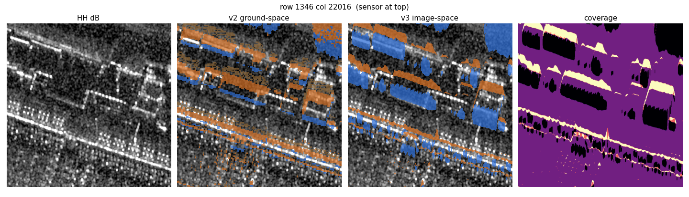
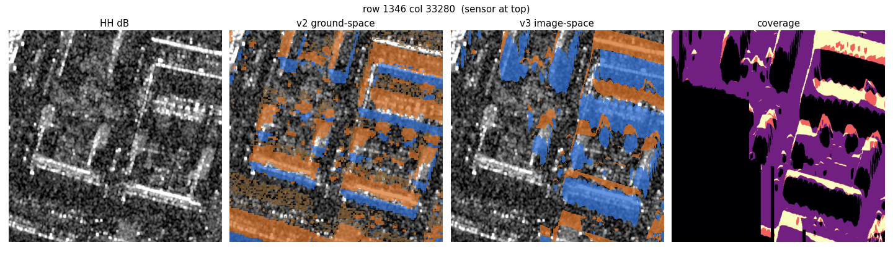

# Image-space layover and shadow

v2 marks where surfaces *are* on the ground. The radar image marks where those surfaces *focused*. Those are different places. A roof focuses closer to the sensor than the building footprint, and the dark region behind a building in the image starts inside that footprint and is longer than the geometric shadow. A neighbour's layover can also land on a geometric shadow and make that pixel bright. The v2 shadow class is not dark in HH (strip mean +0.16 dB, and positive on most strips). The v2 passive class is.

This note is the first image-space projection of the AHN DSM into the MAG-POL grid, on one strip, `20190822074237_20190822074521`. It was a gate, not a dataset. Both gates failed. No tiles were written. Dataset v2 was not modified.

Code: [`sar/image_space.py`](sar/image_space.py), runner [`sar/image_space_run.py`](sar/image_space_run.py), closed-form tests [`sar/tests/test_image_space.py`](sar/tests/test_image_space.py). Labels and crops: [`sar/output/image_space/`](sar/output/image_space).

## What the product actually is

Capella focused every output pixel at a 3D point on SRTM GL1, laid out on a UTM grid. Both the MAG-POL and the SLC JSON say the same thing:

| field | value |
|---|---|
| `collect.image.algorithm` | `backprojection` |
| `image_geometry.type` | `surface` |
| `image_geometry.surface_type` | `affine` |
| `image_geometry.z.dem_name` | `SrtmGl1` |

There is no slant-range axis left in the raster. A scatterer that is not on SRTM (a roof, a wall) focuses where the SRTM surface has the same closest-approach range to the flight line, in the same plane perpendicular to the track. Along one cross-track line, a surface point with range `r` appears at the image cell whose reference-surface point has `r_ref == r`.

| | size | grid |
|---|---|---|
| MAG-POL | 3204 × 47260, EPSG:32631 | north-up, exactly 0.25 m, origin (592256.86 E, 5749728.96 N) |
| SLC HH | 47228 × 2485, EPSG:32631 | rotated, ~0.25 m, origin (592256.86 E, 5749549.18 N) |

The pixels that were projected are the north-up MAG-POL grid. The JSON geotransform is the rotated SLC affine on both files; it was not used.

## Projection

Flight line, look, and closest-approach geometry are the same as [NEAR_FIELD.md](NEAR_FIELD.md): 328 state vectors, straight line in ENU at the centre target, residual rms 8.06 m, platform 1614 m above the target, look **180.180°** (right of track). The sensor is already at row 0 of the MAG-POL image, so nothing was flipped.

For each cross-track line:

1. Visibility. A DSM cell is visible if its off-nadir angle is at least the maximum of every closer cell. A segment whose far end is hidden is hidden. A segment that emerges from shadow is clipped to the point where its angle reaches the occlusion threshold.
2. Map every visible segment's closest-approach range onto the reference surface by inverting `r_ref`.
3. Accumulate coverage: how many surfaces, in cell widths, land on each image pixel.

| coverage | class | code |
|---|---|---:|
| `< 0.5` | shadow — nothing sends energy here | 2 |
| `0.5` to `1.5` | nominal — one surface | 0 |
| `≥ 1.5` | layover — two or more surfaces summed | 1 |
| touched by a hole in the DSM | unknown | 255 |

Coverage is also the severity. Three typically means ground + wall + roof in one pixel.

On a flat reference, a point `(y, z)` under a platform at height `H` focuses at

```
y'          = sqrt(y² − 2 H z + z²)
roof near   = sqrt(g² − 2 H h + h²)
roof far    = sqrt((g+w)² − 2 H h + h²)
shadow end  = (g+w) · H / (H − h)
```

The image shadow `[roof far, shadow end)` starts *inside* the footprint. For `H = 1614 m` and a 40 m × 20 m box that is the case the tests check. Flat ground returns coverage 1. Nine closed-form tests pass (`python sar/tests/test_image_space.py`).

The DSM is AHN at 1 m, NAP converted to ellipsoidal with NLGEO2018, upsampled to 0.25 m. The grid is padded 200 m past the image on the near and far edges, because layover comes in from outside the far edge and shadow from outside the near edge. Water is AHN nodata in connected components of at least 2500 m², filled at a single level. Other nodata stays NaN, and any cell within 400 px (100 m) of such a hole is marked unknown, because a missing tall object there could hide or layover onto the neighbours.

Water level on this strip: **−0.335 m NAP**, the median of land within 2 m of that water and below 2 m NAP. Water is 18.7% of the 1 m grid. Other nodata is 1.0%. The 100 m margin around that 1% is why unknown is large.

| class | fraction of the strip |
|---|---:|
| nominal | 55.6% |
| layover | 7.7% |
| shadow | 10.5% |
| unknown | 26.3% |

## Reference surface

The reference has to be the surface the processor focused onto, in the same vertical frame as the platform. SRTM GL1 tile N51E004, plus EGM96 (`us_nga_egm96_15`). At the centre target, 51.886074 N, 4.426332 E:

| | height |
|---|---:|
| SRTM orthometric | 4.000 m |
| EGM96 N | 43.632 m |
| SRTM ellipsoidal | 47.632 m |
| centre-target ellipsoidal | 45.962 m |
| SRTM − target | **+1.670 m** |

The gate was 2 m. It passed. Incidence along the centre column of the projected grid is 23.8° / 34.6° / 43.1° (near / centre / far), against 24.4° / 34.6° / 42.8° in the v2 strip catalog.

Three references were projected, because the registration below failed on the first:

| directory | reference |
|---|---|
| `sar/output/image_space/egm96/` | SRTM + EGM96, the one that should match the processor |
| `sar/output/image_space/nogeoid/` | SRTM orthometric, geoid omitted (~44 m low) |
| `sar/output/image_space/flat/` | constant height 45.962 m, the centre target |

Each directory has `*_lab.tif` (class), `*_cov.tif` (coverage), `*_water.tif`.

## 1. Passive layover is the bright class

Median HH minus nominal, every v2 tile, before any image-space label was built. Active and shadow *means* are the published v2 numbers. Passive is the median of class 2.

| strip | tiles | active − nom (mean) | shadow − nom (mean) | passive − nom (median) |
|---|---:|---:|---:|---:|
| `20190804111224_20190804111453` | 197 | +3.50 | +0.49 | +1.42 |
| `20190804143846_20190804144102` | 183 | +3.25 | +0.52 | +1.26 |
| `20190822071025_20190822071321` | 75 | +2.93 | −0.91 | +2.36 |
| `20190822074237_20190822074521` | 212 | +2.98 | +0.45 | +1.28 |
| `20190822083256_20190822083600` | 81 | +3.66 | −0.09 | +1.50 |
| `20190822084226_20190822084526` | 447 | +3.11 | +0.29 | +1.36 |
| `20190822085151_20190822085445` | 310 | +2.72 | +0.77 | +1.22 |
| `20190822090458_20190822090745` | 203 | +2.09 | +0.38 | +0.64 |
| `20190822133333_20190822133635` | 264 | +3.25 | +0.27 | +1.30 |
| `20190822134328_20190822134645` | 231 | +2.54 | −0.64 | +1.78 |
| `20190822162246_20190822162529` | 443 | +3.74 | +0.15 | +2.12 |
| `20190823065021_20190823065333` | 271 | +3.49 | +0.22 | +1.66 |
| `20190823072627_20190823072925` | 51 | +2.08 | −0.14 | +2.14 |
| `20190823083119_20190823083425` | 421 | +3.67 | +0.47 | +1.94 |
| `20190823085011_20190823085317` | 251 | +3.87 | +0.89 | +2.22 |
| `20190823124221_20190823124528` | 257 | +2.71 | −0.84 | +1.96 |
| `20190823125228_20190823125530` | 66 | +2.63 | −0.88 | +2.02 |
| `20190823134629_20190823134924` | 6 | +2.16 | +0.87 | +2.68 |
| all | 3969 | +3.14 | +0.16 | +1.60 |

Passive is brighter than nominal on every strip, from +0.64 dB to +2.68 dB. Shadow is not. The bright mixed return in the ground-space labels is the passive class, not the shadow class.

## 6. Registration

The label image (+1 layover, −1 shadow, 0 elsewhere, unknown excluded) is cross-correlated with HH dB. Eight windows of 1024 × 1024, spread along the strip, centre-range band only. Search is ±300 px (75 m), wide enough that a missing geoid (~44 m, about 250 px in range at 35°) would still land inside the window. A window is kept only if at least 80% of HH is finite and at least 2% of the window is layover or shadow. The reported shift is the one to apply to the labels. Pass is |dy| ≤ 2, |dx| ≤ 2, and peak > 0.1.

Only 3 of 8 windows on the image-space labels had enough layover in that centre band. Unknown is 26% of the strip, and layover is a thin band, so most windows were dropped.

| reference | windows | median dy | dx | peak | pass |
|---|---:|---:|---:|---:|---|
| SRTM + EGM96 | 3 | +40 | +5 | 0.155 | no |
| SRTM, no geoid | 3 | +300 | +2 | 0.067 | no |
| flat, 45.962 m | 3 | +62 | +3 | 0.165 | no |

EGM96 windows, the reference that should have been right:

| along-track column | dy | dx | peak |
|---:|---:|---:|---:|
| 2953 | +40 | +5 | 0.155 |
| 20676 | +48 | 0 | 0.081 |
| 32491 | +28 | +5 | 0.181 |

Positive dy moves the labels away from the sensor (sensor is row 0). The bright return sits 28–48 px, about 7–12 m, further from the sensor than the layover polygon. Dropping the geoid drives the peak to the search limit (+300 px) and the correlation collapses (peak 0.067). The flat surface is worse than EGM96, not better (median +62 px; one of its three windows is an outlier at +273).

v2 labels on the same function, with active and passive both counted as layover: 8 windows, median dy **+13.5**, dx **+1.5**, peak **0.182**. Also outside 2 px, but closer than the image-space mask, and every window survived.

This is not a 10 m grid bug. On the centre column, DSM cells within 1 m of the EGM96 surface project back onto themselves within about **+1.2 px**. The coordinate frame is consistent. The correlation peak is telling us the bright edge is not where the layover polygon's mass is.

## 7. Physics

Median HH minus the nominal median, water and unknown excluded. Same 0.02 dB histogram as the passive check. Pass would be layover ≥ +2.0 dB overall, and shadow ≤ −1.5 dB overall and negative in every range third.

| range | v3 layover | v3 shadow | v2 active | v2 passive | v2 shadow |
|---|---:|---:|---:|---:|---:|
| all | +1.64 | −0.04 | +1.74 | +1.22 | −0.14 |
| near | +1.30 | −0.32 | +1.56 | +0.86 | −0.30 |
| middle | +1.60 | −0.18 | +1.62 | +1.24 | −0.40 |
| far | +2.10 | +0.46 | +2.04 | +1.58 | +0.32 |

Fail on both. Layover is under +2 dB except in the far third (8.6 million layover pixels, 12.4 million shadow pixels, dry and known). Shadow is barely negative near and in the middle, and **positive in the far third**. On this full strip the v2 shadow *median* is slightly negative (−0.14 dB), unlike the tile-mean +0.45 dB published for the same strip. v2 passive on the same pixels is still bright (+1.22 dB).

The crops show the same offset the correlation measured. Image-space layover is a thin band on the near side of each building (toward row 0). Image-space shadow covers the bright footprint. Coverage is high on that near-side band and near zero on the building itself. Ground-space v2 does the opposite: orange (active and passive) sits on the bright roof, blue shadow sits past the far wall.

Crops are 512 × 512, row 1346, sensor at the top. Orange is layover, blue is shadow. Coverage is yellow where several surfaces stack and black where nothing does.

| file | column |
|---|---:|
| [crop_00_1346_0.png](sar/output/image_space/egm96/crop_00_1346_0.png) | 0 |
| [crop_01_1346_7168.png](sar/output/image_space/egm96/crop_01_1346_7168.png) | 7168 |
| [crop_02_1346_22016.png](sar/output/image_space/egm96/crop_02_1346_22016.png) | 22016 |
| [crop_03_1346_33280.png](sar/output/image_space/egm96/crop_03_1346_33280.png) | 33280 |
| [crop_04_1346_39424.png](sar/output/image_space/egm96/crop_04_1346_39424.png) | 39424 |
| [crop_05_1346_43520.png](sar/output/image_space/egm96/crop_05_1346_43520.png) | 43520 |

Two of them:





## What this does not say

The closed-form box is right, and flat ground projects onto itself. The failure is on the real strip: the bright pixels are not inside the image-space layover class, and the image-space shadow class is not dark. Shifting the reference surface the wrong way (no geoid, or a flat plane) makes the alignment worse, so the EGM96 surface is the least wrong of the three, and it is still 10 m off in range.

Nothing past this gate was built. No tiles, no norm stats, no change to `dataset_v2` or to the v2 masks.
