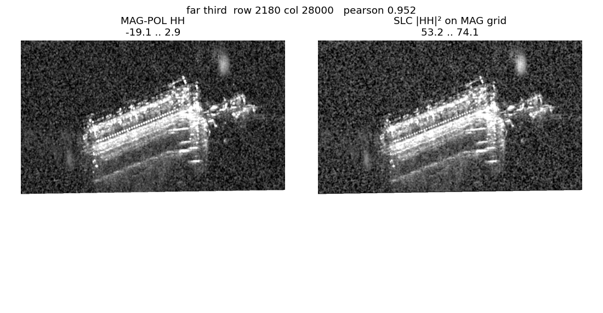
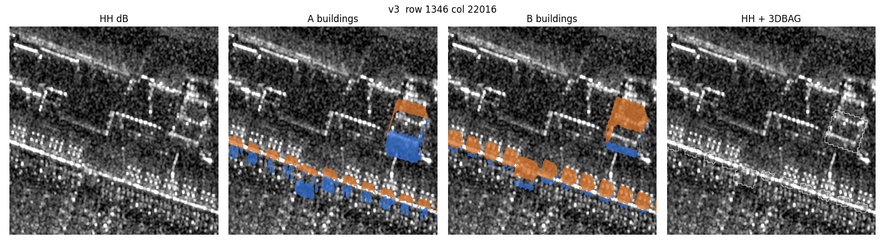
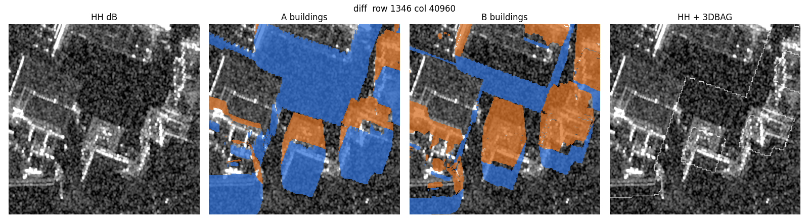
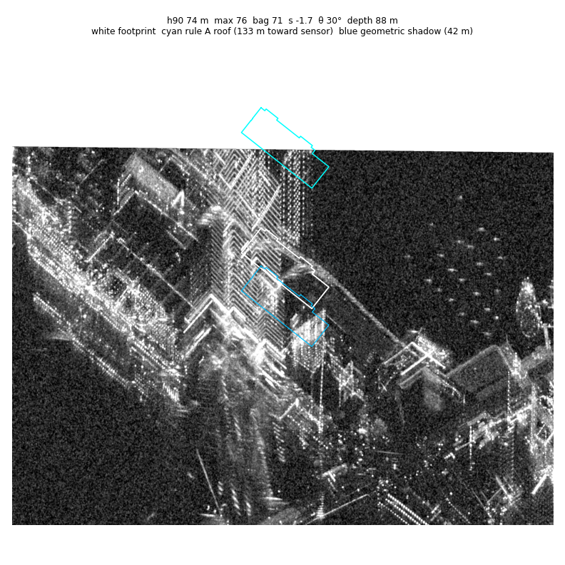
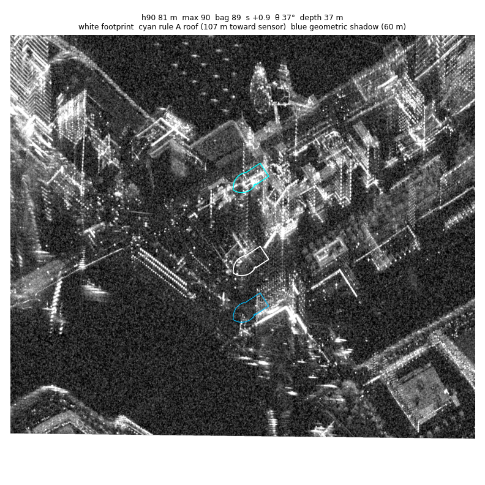
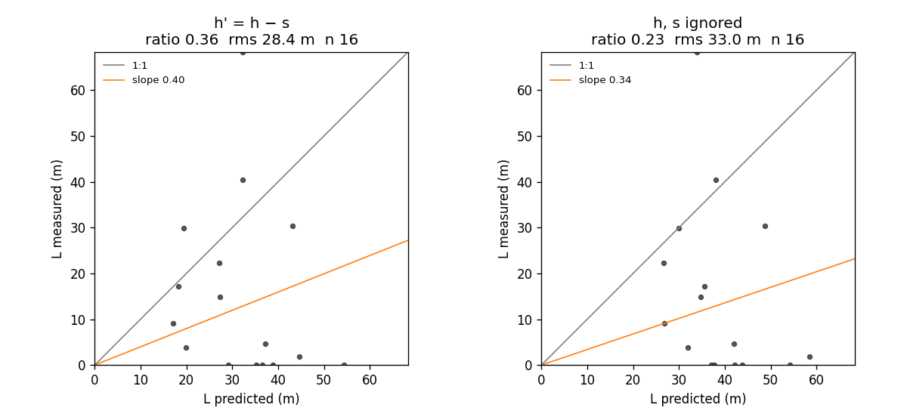
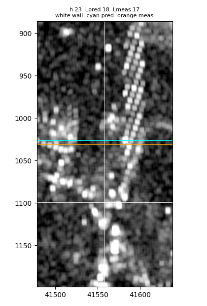
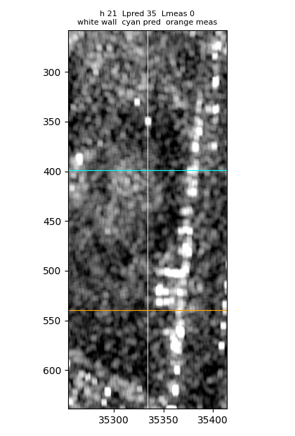

# Two placement rules, judged on the image

The image-space labels in [IMAGE_SPACE.md](IMAGE_SPACE.md) failed both gates on strip `20190822074237_20190822074521`. They sat 28–48 px closer to the sensor than the bright pixels, and shadow was −0.04 dB. [SHIFT_CHECK.md](SHIFT_CHECK.md) then showed that middle-swath water is already at the map, that the SLC and the MAG-POL are the same picture, and that the bright roofs sit on the lidar footprint rather than on the SRTM roof outline.

This note builds labels under two placement rules and scores them against HH. It does not propose a third rule. Dataset v2 was not modified. No tiles were built.

| rule | where a surface is written |
|---|---|
| A, lean | `image_space.project_grid`. Closest-approach range onto SRTM, the v3 rule. |
| B, in place | `image_space.own_range_grid`. The surface stays on its own map column. Shadow is the geometric shadow. |

Two surfaces, same grid, padding, `r`, `alpha`, and SRTM `r_ref` as v3:

| scene | surface |
|---|---|
| full | the v3 DSM |
| bldg | local ground everywhere, AHN only inside 3DBAG `pand` footprints dilated 1 m |

Five label sets: v2, A-full, A-bldg, B-full, B-bldg. v2 codes are remapped for the comparison (`1` and `2` are layover, `3` is shadow). Water is filled as in v3. Nodata holes smaller than 100 m² are filled from the median of the surrounding DSM. `nan_margin=400` is kept only around the holes that are left.

Code: [`sar/rule_check.py`](sar/rule_check.py), [`sar/towers.py`](sar/towers.py), and the two rules in [`sar/image_space.py`](sar/image_space.py). The closed-form file is 15 tests, the original nine plus the in-place cases. All 15 pass. Numbers and crops: [`sar/output/rule_check/`](sar/output/rule_check).

The strip is the port MAG-POL, 3204 × 47260, EPSG:32631, 0.25 m, origin (592256.86 E, 5749728.96 N). Look 180.180°, platform 1614 m. The sensor is row 0. HH is band 1, already in dB. Local ground is the 5th percentile of the DSM within 50 m. There is no DTM. `s` is SRTM GL1 plus EGM96, minus that ground in ellipsoidal height.

## 1. Basics

Open water is water more than 30 m from a shore. Each number is the median of 1 m means of the 0.25 m HH.

| third | open water | land | water − land | n water (1 m) |
|---|---:|---:|---:|---:|
| near | −15.24 | −12.78 | −2.46 | 282,847 |
| middle | −15.36 | −13.03 | −2.32 | 294,312 |
| far | −15.29 | −13.44 | −1.85 | 212,024 |

A dark class that landed on water-like pixels would be about 2 dB below land. The shadow class in the gate below is not.

The DSM raster is AHN4, acquired 2020–2022 (PDOK WCS coverage `dsm_05m`). 3DBAG v20250903 tags its own point cloud per building. On this strip most of those tags are AHN5 / 2022, with a minority AHN4 / 2020 and AHN3 / 2016. That is the building model, not the raster.

The far-third SLC and MAG-POL are the same picture wherever both are finite. An earlier far-third cross-correlation failed because MAG nodata was filled with 0 dB, which is bright, before the boxcar. On the finite pixels the correlation is not that failure. The window below is row 2180, column 28000, 1024 px. Both products are finite on the same 57.6% of it, neither has zeros, and Pearson on those pixels is **+0.95**. Further south, around row 2800, both are empty: the swath is rotated inside the north-up rectangle and does not fill the corner.

## 2. What was labelled

Holes filled: 5,240 holes, 23,778 m². Larger holes left as nodata: 119,611 m². Water level used for the fill is **−0.33 m NAP**.

Unknown, as a fraction of the image (v3 was 26%):

| set | unknown |
|---|---:|
| A-full | 12.17% |
| B-full | 12.09% |
| A-bldg | 0% |
| B-bldg | 0% |

Buildings-only has no unknown because the surface is local ground plus AHN inside the dilated footprints, so no DSM hole remains.

On the 1 m padded grid: footprints 9.06% (1.29 km²), dilated 10.4%, clutter core (nDSM > 3 m outside a footprint) 24.4%, that core dilated 30 m **87.7%**, water 18.7%. Footprints that are neither clutter nor water: 112,905 m², about 9% of the footprint area. The 30 m buffer eats the buildings. That matters for the registration below.

## 3. Brightness

The evaluation mask is the pixels known in all five sets, not water, and not clutter. It is the same pixels for every set: 4,087,233, which is 2.70% of the image. The medians use the finite-HH part of that mask. dB is the class median minus the nominal median. The pass line for this run is layover ≥ +1.5 dB in the near third and the middle third, and shadow ≤ −1.5 dB in both. The far third is reported and not gated.

| set | near lay | near sh | mid lay | mid sh | far lay | far sh | near lay share | near sh share | mid lay share | mid sh share |
|---|---:|---:|---:|---:|---:|---:|---:|---:|---:|---:|
| v2 | +2.04 | −0.16 | +3.07 | −0.80 | +3.53 | +0.32 | 13.2% | 1.6% | 5.7% | 0.31% |
| A-full | +1.90 | −0.06 | +2.64 | −0.46 | +0.13 | +0.57 | 7.6% | 5.1% | 2.0% | 2.9% |
| A-bldg | +1.98 | −0.07 | +2.92 | −0.47 | +0.37 | +0.48 | 7.5% | 5.2% | 1.9% | 2.9% |
| B-full | +1.90 | −0.41 | +3.22 | −0.81 | +3.57 | +0.27 | 15.1% | 1.4% | 6.1% | 0.31% |
| B-bldg | +1.94 | −0.42 | +3.64 | −0.88 | +4.21 | +0.26 | 15.0% | 1.4% | 5.7% | 0.28% |

Finite eval pixels: 998,572 near, 740,296 middle, 916,567 far.

Layover passes in the near and middle thirds for every set. Shadow fails in both thirds for every set. The closest shadow is **B-bldg** (−0.42 near, −0.88 middle). B-full is almost the same. A is worse. A's far-third layover collapses to about 0: the SRTM projection walks the tall returns off the footprints. B's class mix matches v2. A labels several times more shadow, which is the footprint painted dark.

## 4. Registration

`registration_check` on the evaluation mask returned **0 windows for every set**, both classes and shadow-only, in every third. Two cuts inside that function drop them. Pixels outside the mask are set to NaN, and a window needs 50% finite HH; the mask is 2.7% of the image. A window also needs layover or shadow on at least 2% of its pixels. The best window on B-bldg is still only 0.66% labelled. Dropping the 50% cut and keeping the 2% cut still kept nothing. The registration half of the pass rule is undefined on the mask that was specified. It is not a measured zero shift.

A separate check, not the gate, correlates on 3DBAG footprints that are not water. The finite test is on the raw HH, and a window is kept at 0.5% labelled. Positive dy means the labels have to move away from the sensor to match HH: they are too close to the sensor. Pass, had this been the gate, would be shadow-only |dy| ≤ 2 and peak > 0.1 in both the near and the middle third.

| set | near both dy / peak (n) | mid both | near shadow | mid shadow |
|---|---|---|---|---|
| v2 | −8 / 0.22 (5) | −2 / 0.19 (5) | 0 / 0.056 (3) | 0 / 0.080 (4) |
| A-full | +22 / 0.19 (5) | +20 / 0.18 (5) | +17 / 0.17 (4) | +18.5 / 0.16 (4) |
| A-bldg | +20 / 0.19 (5) | +17 / 0.21 (5) | +12 / 0.17 (5) | +13 / 0.16 (5) |
| B-full | −6 / 0.25 (5) | −5 / 0.24 (5) | 0 / 0.093 (3) | −3 / 0.114 (4) |
| B-bldg | −12 / 0.23 (5) | −7 / 0.20 (5) | +17.5 / 0.12 (2) | −2.5 / 0.12 (4) |

No set passes shadow-only in both thirds. The closest is B-full: middle dy −3 px, peak 0.11; near dy 0, but the peak is 0.093 and only 3 windows. A is the v3 failure, smaller. Its shadow is 12–18 px too close to the sensor. B's middle shadow is a few pixels the other way.

**None of the five sets passes.** Layover brightness passes for all five. Shadow darkness fails for all five, and B-bldg is the closest. The specified registration kept no windows. On the footprint diagnostic, B-full is the closest alignment and A is still shifted toward the sensor.

## 5. Crops

512 × 512, sensor at the top. Left to right: HH, A-bldg, B-bldg, HH with the 3DBAG outline in white. Orange is layover, blue is shadow. The six positions are the v3 crops, at row 1346. Three more are the columns where A-bldg and B-bldg disagree most inside the evaluation mask, at the same row: column 40960 (18,433 pixels), 24064 (462), 32768 (138).

| file | column |
|---|---:|
| [crop_v3_1346_0.png](sar/output/rule_check/crop_v3_1346_0.png) | 0 |
| [crop_v3_1346_7168.png](sar/output/rule_check/crop_v3_1346_7168.png) | 7168 |
| [crop_v3_1346_22016.png](sar/output/rule_check/crop_v3_1346_22016.png) | 22016 |
| [crop_v3_1346_33280.png](sar/output/rule_check/crop_v3_1346_33280.png) | 33280 |
| [crop_v3_1346_39424.png](sar/output/rule_check/crop_v3_1346_39424.png) | 39424 |
| [crop_v3_1346_43520.png](sar/output/rule_check/crop_v3_1346_43520.png) | 43520 |
| [crop_diff_1346_40960.png](sar/output/rule_check/crop_diff_1346_40960.png) | 40960 |
| [crop_diff_1346_24064.png](sar/output/rule_check/crop_diff_1346_24064.png) | 24064 |
| [crop_diff_1346_32768.png](sar/output/rule_check/crop_diff_1346_32768.png) | 32768 |

Column 22016 is the clear case. A paints the footprint blue, with a thin orange line on the near wall. B paints that footprint orange and puts a thin blue band on the far side. The bright HH pixels sit on the white outline. That is B's orange and A's blue.

The same pattern where the two rules disagree most:

## 6. Tall buildings

The port strip has no solid building over 40 m with 25 m of range depth that survived the isolation cuts. The strip that covers De Rotterdam and the Maastoren is `20190823072627_20190823072925` (look 0.46°, platform 1619 m). The image is north-up and the sensor is at the south edge, so the crops are flipped. The sensor is at the top of the figures.

AHN maximum within 300 m of the published coordinates: De Rotterdam 163.6 m NAP (95th percentile 85.6 m), Maastoren 175.7 m NAP (95th percentile 40.0 m). The Maastoren peak is a spike. The 3DBAG page for that box returned no pand with bag roof-minus-ground over 40 m, so Maastoren is not drawn.

Four pands in the De Rotterdam box (RD 92850–93450 E, 435350–435950 N) cleared bag height > 40 m and range depth ≥ 25 m. They are the largest by bag height times footprint area, not a claim that each one is the named tower. White is the 3DBAG footprint. Cyan is that footprint moved `(h90 − s) / tan θ` toward the sensor. Blue is the geometric shadow, `h · tan θ`, drawn the other way. `h90` is the 90th percentile of nDSM inside the footprint.

The cyan side was checked on the pixels. On pand `0599100100010084` the cyan line has mean row 209 and the shadow line mean row 411. On `0599100000691047` those rows are 293 and 472. The top of the flipped crop is the sensor, so cyan is on the sensor side of the footprint.

| pand | h90 | h70 | bag h | depth | s | θ | roof shift | shadow |
|---|---:|---:|---:|---:|---:|---:|---:|---:|
| 0599100000750601 | 137 | 42 | 90 | 76 m | −1.3 | 25° | 290 m | 65 m |
| 0599100000691020 | 119 | 84 | 83 | 83 m | −2.4 | 27° | 235 m | 61 m |
| 0599100100010084 | 74 | 72 | 71 | 88 m | −1.7 | 30° | 133 m | 42 m |
| 0599100000691047 | 81 | 79 | 89 | 37 m | +0.9 | 37° | 107 m | 60 m |

The first is not a solid 137 m roof. Its 70th percentile is 42 m, and the 290 m cyan outline leaves the ±300 m window (no cyan pixels left in the crop). The building also sits on the near-range edge of the swath, in nodata. The second is the same kind of crop: five cyan pixels remain. Neither is usable as a picture of the rule.

The other two are solid roofs, and both are on the image. The bright texture is inside the white footprint. The ground between cyan and white is not a bright smear of the predicted length. The dark water around them is the river. It is not a shadow band that starts at the back wall. Inside the white outline the return is bright, not dark, and not dark with only a bright top edge.

3DBAG's bag height is below the AHN 90th inside the same polygon on the first two (90 m against 137 m, 83 m against 119 m). The outlines use the lidar 90th, which is why those two shifts are so long. These are real 2019 buildings, and they are not drawn at the rule-A roof position.

## 7. Layover length

Port strip only. 144 candidate columns on 3DBAG buildings with a facade `h90` ≥ 20 m. A column is dropped if another footprint sits within 1.5 predicted lengths in front (81), or if the window falls off the image (20). None were dropped for water or for geometry. 16 buildings kept.

`L_pred = g − √(g² − 2 H h′ + h′²)`, with `h′ = h_edge − s`, and `g`, `H` from the perpendicular geometry at the ground point.

| height used | n | median measured / predicted | slope through the origin | RMS to the 1:1 line |
|---|---:|---:|---:|---:|
| h′ = h − s | 16 | 0.36 | 0.40 | 28.4 m |
| h, s ignored | 16 | 0.23 | 0.34 | 33.0 m |

Using `h′` is the less bad of the two. Neither is a confirmation. The tallest kept facade is 44 m, predicted length 45 m, measured length 1.9 m. Several measured lengths are 0. In the crops the bright pixels sit on the building side of the near wall, not out at the cyan mark.

The closest of the twelve examples is building 6022, ratio 0.94. Building 3962 is a zero, predicted 35 m.

The other ten are `layover_01` through `layover_07` and `layover_09` through `layover_11` in the same directory.

## What this does and does not say

Rule A is the projection the product JSON describes, and it is the one the image rejects. Bright roofs stay on the lidar footprint. A's shadow correlation wants those labels moved 12–20 px away from the sensor. Rule B puts the bright class on those roofs and is closer on every number that could be measured. Its shadow is still only about −0.4 to −0.9 dB, against a water floor of about −2.3 dB, and the shadow-only shift is not inside 2 px with a peak above 0.1.

The layover-length formula is not supported on this strip. Sixteen buildings, median ratio 0.36.

The clutter definition is why the official registration is empty. A 30 m dilation of everything taller than 3 m outside 3DBAG removes about 90% of the building pixels, so that gate is scored on open ground. The footprint table is a diagnostic. It was not substituted for the specified mask.

No new rule was applied. No tiles were built. Dataset v2 was not modified.
