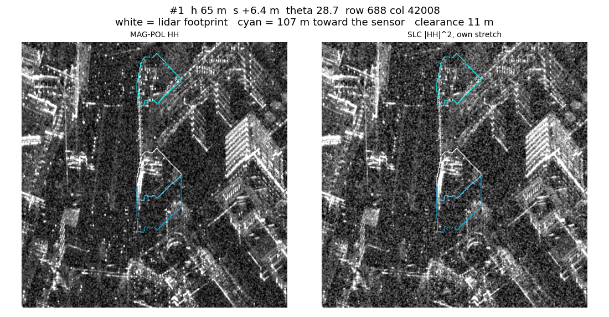
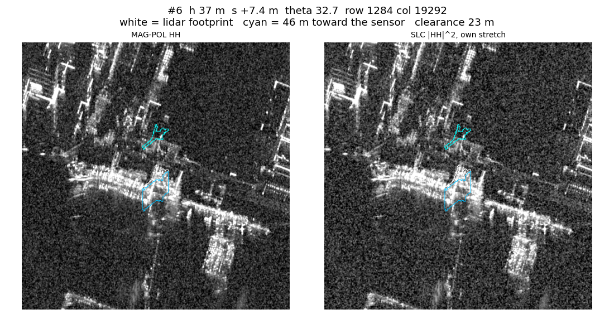

# Where the image actually puts the ground

The image-space labels in [IMAGE_SPACE.md](IMAGE_SPACE.md) failed both gates on strip `20190822074237_20190822074521`. v3 sat 28–48 px (about 10 m) closer to the sensor than the bright pixels, v3 shadow was not dark (−0.04 dB), and the crops showed bright roofs on the building footprints. v2 aligned better (+13.5 px) than v3 (+40 px).

This note does not propose a new focusing rule. It measures, on that same strip, where flat ground and buildings land in the MAG-POL image. Dataset v2 was not modified. No tiles were built. `sar/image_space.py` and `sar/output/image_space/` were not written to.

Code: [`sar/shift_check.py`](sar/shift_check.py). Numbers and crops: [`sar/output/shift_check/`](sar/output/shift_check).

Offsets are metres along range. **Positive is away from the sensor.** Row 0 is the sensor. HH is MAG-POL band 1, already in dB. There is no AHN DTM on disk, so local ground is the 5th percentile of the DSM within 50 m. `s` is SRTM GL1 plus EGM96, minus that ground in ellipsoidal height. Across the strip the median of `s` is **+1.8 m** (p10 −0.8 m, p90 +5.1 m). Incidence of that ground surface is 27.7° / 34.6° / 40.5° in the near / middle / far third.

## 1. Flat ground

Water edges are sharp and have no height. Windows are 1024 × 1024 px, four along-track positions by three range thirds. A window is kept only if water is 10–90% of it and nDSM above 3 m is under 5%. If a third has no such window, the building limit is relaxed to 15%.

The water flag is correlated with −HH (water is dark), search ±300 px. The same flag is then moved by the SRTM rule: every DSM cell more than 2 m above local ground is set to local ground, closest-approach range is computed as in v3, and each cell is sent to the image row `np.interp(r, r_ref, rows)`. `r_ref` increased on every step.

| third | n | map water vs image | after the SRTM move | dz = dy·tan θ | s in the window |
|---|---:|---|---|---:|---:|
| near | 1 | **+6.5 m**, dx +3.8 m, peak 0.26 | +3.2 m, peak 0.26 | +3.4 m | +0.7 m |
| middle | 2 | **0.0 m**, dx 0.0 m, peaks 0.53 and 0.27 | 0.0 m, peaks 0.53 and 0.28 | 0.0 m | +2.2 m and +1.2 m |
| far | 0 | — | — | — | — |

Near range needed the 15% relaxation (one window, 14.5% built, 57% water). The far third still has no window. Its four candidates, as water fraction / built fraction, are 0.00/0.22, 0.27/0.41, 0.74/0.17 and 0.08/0.10.

The middle of the swath is not a georeferencing offset, and it is not a reference-surface height error. The dark water is already where the map puts it. Moving the flag by the SRTM rule does not improve the peak. The height error that would explain the one near-range window (+3.4 m) is larger than the `s` measured in that window (+0.7 m). One window is not a slope.

## 2. SLC and MAG-POL are the same image

Both files carry the same JSON and the same rotated affine, so the MAG-POL metadata could have been a copy. `|SLC HH|²` was converted to dB and resampled with the SLC's own affine onto the MAG-POL grid, bilinear, then a 5 × 5 boxcar on both.

The SLC affine is rotated 0.87°, not axis-aligned. The print of the transform rounds the small terms to 0.00. At full precision:

| | along track | across track |
|---|---|---|
| SLC | row axis, azimuth 89.13°, 0.250 m/px, 47228 px = 11807 m | column axis, bearing 179.13°, 0.250 m/px, 2485 px = 621 m |
| MAG-POL | column axis, due east, 0.250 m/px, 47260 px = 11815 m | row axis, due south, 0.250 m/px, 3204 px = 801 m |

The 180 m difference in range sample count is a narrower swath at the same pixel size, not a different spacing. The rotation lifts the east end of the SLC by 180 m relative to its west end, which is why the axis-aligned bounding boxes disagree in northing by that much. The south-west corners agree (5748928.01 N versus MAG-POL south 5748927.96 N). The SLC covers 77.5% of the MAG-POL pixels, which is 621 / 801.

Windows are 1024 × 1024, one over buildings (nDSM > 3 m on at least 20%) and one over open ground (under 2%), in each of four along-track zones and three range thirds. The shift is the one applied to the SLC to match the MAG-POL. A blank open window means that quarter has no 1024 px patch under 2% built.

| zone | third | kind | overlap | dy | peak |
|---|---|---|---:|---:|---:|
| 0 | near | buildings | 0.46 | 0.0 m | 0.89 |
| 0 | middle | buildings | 1 | 0.0 | 0.94 |
| 0 | far | buildings | 1 | −22.8 m | 0.11 |
| 1 | near | buildings | 0.54 | 0.0 | 0.83 |
| 1 | middle | buildings | 1 | 0.0 | 0.98 |
| 1 | middle | open | 1 | 0.0 | 0.92 |
| 1 | far | buildings | 1 | −64 m | 0.06 |
| 2 | near | buildings | 0.81 | +0.25 m | 0.89 |
| 2 | near | open | 0.73 | +0.25 | 0.74 |
| 2 | middle | buildings | 1 | 0.0 | 0.94 |
| 2 | middle | open | 1 | 0.0 | 0.90 |
| 2 | far | buildings | 1 | −64 m | −0.16 |
| 2 | far | open | 1 | −64 m | −0.12 |
| 3 | near | buildings | 0.93 | +0.25 m | 0.92 |
| 3 | middle | buildings | 1 | 0.0 | 0.95 |
| 3 | far | buildings | 1 | +64 m | −0.11 |

Where the peak locks (0.74–0.98), the shift is 0 or 1 px, on buildings and on open ground, in the near third and the middle third. The far-third shifts sit on the ±64 m edge of the search and the peaks are about 0 or negative. Those are not a measured shift. Buildings are not displaced between the two products relative to open ground. The MAG-POL was not redrawn onto a different surface after focusing.

## 3. Buildings averaged by height

Footprints are 3DBAG `pand` (roof and ground heights are in the file: `b3_h_nok`, `b3_h_maaiveld`). `h` is the 70th percentile of nDSM inside the footprint, not the BAG ridge height. 4849 footprints fall on the strip. 3119 have `h ≥ 3 m`.

A building is kept only if, along the columns through the middle half of its along-track extent, no other cell with nDSM > 3 m sits within 60 m in front of the near wall or 60 m behind the far wall. A 3 m skirt around the polygon is not counted, so the lidar edge of the same building is not a neighbour. If a height bin then has fewer than 100 buildings, the gap is relaxed to 30 m.

It does not help. Median clearance on the centre column, over 3086 buildings, is **0 m**. Eleven buildings have 60 m clear on that one column. Requiring every column in the middle half leaves **2** buildings at 60 m and **9** at 30 m. No height bin reaches 100, in any third. The bins that have anything:

| third | bin (m) | n | columns | h | D | θ | s | SRTM roof-near | leading edge |
|---|---|---:|---:|---:|---:|---:|---:|---:|---:|
| near | 6–10 | 3 | 324 | 7.3 | 13 | 24.2° | −0.2 | −16 m | none (water in front, no background) |
| middle | 6–10 | 1 | 48 | 7.2 | 11 | 37.4° | −1.9 | −12 m | −160 m |
| middle | 15–25 | 1 | 64 | 17.5 | 24 | 35.1° | +5.9 | −16 m | −142 m |
| far | 3–6 | 3 | 40 | 3.6 | 8 | 41.4° | −0.4 | −5 m | −152 m |
| far | 6–10 | 1 | 16 | 6.8 | 10 | 40.9° | −0.6 | −9 m | none |

`D` is the footprint depth along range. The SRTM roof-near line is `−(h − s) / tan θ`. The leading edges at −140 to −160 m are the start of the stacked profile, not a roof: the 1 dB test fires on the first sample. Median land HH, water excluded, is −13.03 dB.

The fit was not made. The middle third has two bins, and every bin has fewer than 20 buildings. A slope from one-building profiles would not be a measurement. The profiles are `check3_profiles_near.png`, `check3_profiles_middle.png` and `check3_profiles_far.png`.

## 4. The tall structures, by eye

Connected components of nDSM > 3 m, area at least 50 m², `h` the 70th percentile. Seven components are above 30 m. None is 100 m from another cell with nDSM > 10 m. Clearance is 2–23 m, so this is not the isolated sample the check asked for. They are the only objects that tall. Crops are ±150 m, sensor at the top.

White is the lidar footprint. Cyan is that footprint moved `(h − s) / tan θ` toward the sensor. Blue is the geometric shadow, a band `h · tan θ` long behind the far wall. The SLC panel is the resampled `|HH|²`, stretched on its own numbers. An earlier draw used the MAG-POL stretch and came out white; the files below do not.

| # | h (max) | s | θ | row, col | cyan, toward the sensor | clearance |
|---|---:|---:|---:|---|---:|---:|
| 1 | 65 m (72) | +6.4 | 28.7° | 688, 42008 | 107 m | 11 m |
| 2 | 44 (46) | +0.3 | 29.1° | 744, 16964 | 79 m | 2 m |
| 3 | 44 (48) | +5.3 | 25.5° | 228, 36368 | 82 m | 7 m |
| 4 | 38 (40) | +0.6 | 26.7° | 388, 60 | 75 m | 2 m |
| 5 | 37 (41) | +4.9 | 24.3° | 64, 41204 | 71 m | 9 m |
| 6 | 37 (69) | +7.4 | 32.7° | 1284, 19292 | 46 m | 23 m |
| 7 | 34 (38) | +5.2 | 24.3° | 60, 42548 | 63 m | 16 m |

On the 65 m structure the bright block fills the white outline. The cyan outline, 107 m closer to the sensor, is on dark ground. The SLC shows the same block in the same place.

Same on the 37 m structure. Cyan is 46 m toward the sensor and does not cover the bright return. MAG-POL and SLC agree with each other.

The other five crops are in the same directory: `check4_02` through `check4_05`, and `check4_07`.

## What this does and does not say

Flat ground in the middle of the swath is at the map position, to the pixel. The SLC and the MAG-POL are the same picture where both exist, including over buildings. The SRTM roof outline, tens of metres closer to the sensor, does not land on the bright pixels of the tall structures. Those bright pixels sit on the lidar footprint.

The height regression was not measured. This strip does not have a hundred isolated buildings in any height bin, and it does not have ten tall structures clear of other tall cells for 100 m. No new label rule follows from that, and none was applied.
