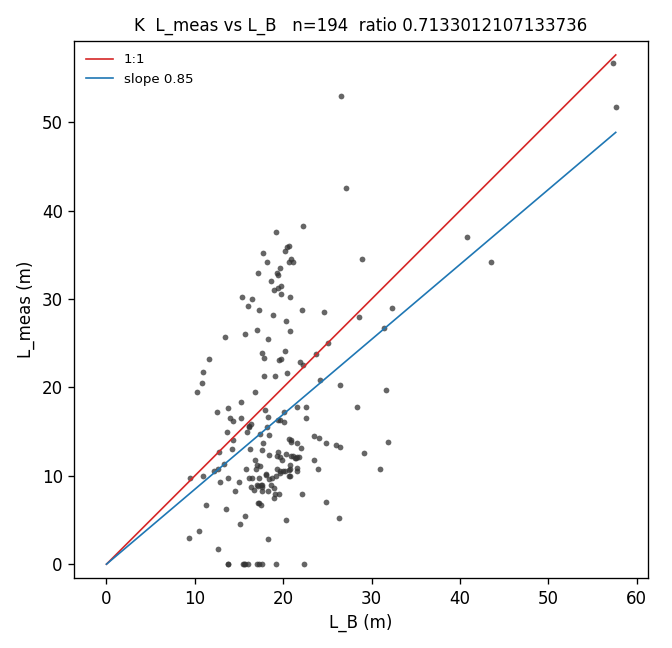
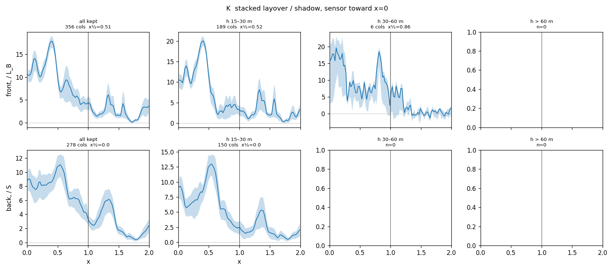

# v4 check — gate failed, no tiles

Rule B (`own_range_grid`) on the buildings-only surface, ground replaced by the AHN4 DTM (`dtm_05m`). Known, non-water pixels. No 30 m clutter dilation. P is `20190822074237_20190822074521`. K is `20190823072627_20190823072925`.

The layover gate is +1.5 dB in the near and middle thirds on **both** strips. P misses it. K passes. No tiles were built. `train.py` was not run.

## 1. Old ground minus DTM

5th-percentile local ground minus the DTM, non-water land, both finite.

| strip | n | median | p10 | p90 |
|---|---:|---:|---:|---:|
| P | 8,847,273 | −0.34 m | −3.19 m | +0.07 m |
| K | 8,018,479 | −0.42 m | −2.78 m | +0.05 m |

The median is a few tens of centimetres (the old ground is slightly lower). The low tail is about 3 m. That is the sunken-street / water-edge bias the DTM removes. It is not a uniform height shift.

## 2a. B-bldg contrast

Median HH minus the nominal median. dB.

| strip | third | layover | shadow | shadow interior (eroded 2 m) | n layover | n nominal |
|---|---|---:|---:|---:|---:|---:|
| P | near | **+1.18** | −0.88 | −1.76 | 6,159,319 | 20,201,097 |
| P | middle | **+1.04** | −1.14 | −1.62 | 4,451,671 | 34,102,977 |
| P | far | +0.78 | −0.58 | −1.22 | 1,055,023 | 25,177,975 |
| P | all | +1.22 | −0.88 | −1.52 | 11,666,013 | 79,482,049 |
| K | near | **+2.16** | −1.20 | −1.08 | 9,643,915 | 18,146,885 |
| K | middle | **+2.62** | −1.18 | −1.34 | 12,186,479 | 28,393,635 |
| K | far | +3.10 | −1.28 | −1.66 | 7,257,122 | 20,955,677 |
| K | all | +2.58 | −1.24 | −1.48 | 29,087,516 | 67,496,197 |

P fails both gated thirds. K clears both. Same code, same DTM, so this is the strip, not a flipped sensor: K's alpha still falls toward the south, and the labels are written north-up.

This is not the rule-check number. That gate was scored on the pixels known in all five label sets and outside the 30 m clutter buffer, about 3% of the port strip, where B-bldg layover was +1.94 / +3.64 dB. Here every known dry pixel is in the median, including the dim tail of the layover class. That is the mask this check asked for, and on P it is under +1.5 dB.

## 2b. Shadow interior

Eroding the shadow class by 2 m makes it darker on P (interior −1.52 against the class −0.88) and slightly darker overall on K (−1.48 against −1.24). K's near third goes the other way (−1.08 interior, −1.20 for the class). Neither interior reaches the open-water floor from DECIDE (about −1.9 to −2.1). Reported only.

## 2c. Roof test

Pixels inside the footprint, eroded 2 m, at least `6 m + max(0, s) / tan θ` behind the near wall. Buildings with nDSM p90 ≥ 8 m and at least 100 pixels in both the layover part (coverage ≥ 1.5) and the nominal part. The number is median HH(layover) − median HH(nominal), then the median over buildings.

|  | n | median dB | fraction > 0 |
|---|---:|---:|---:|
| P all | 55 | +0.50 | 0.67 |
| P 8–15 | 23 | +0.52 | 0.74 |
| P 15–30 | 27 | +0.50 | 0.67 |
| P > 30 | 5 | −0.54 | 0.40 |
| K all | 333 | +0.95 | 0.71 |
| K 8–15 | 204 | +1.10 | 0.74 |
| K 15–30 | 105 | +0.91 | 0.67 |
| K > 30 | 24 | +0.78 | 0.63 |
| pooled | 388 | +0.87 | 0.70 |

Pooled median is +0.87 dB and 70% of buildings are positive. That is between the two bars (+1.0 with fraction ≥ 0.6, or below +0.5). The rule says keep rule B and say so. It does not justify the roof-nominal edit. It also does not override the failed brightness gate.

## 2d. Layover length on K, DTM ground

Same column rule as DECIDE.md Part 2. Kept 386 columns, 208 buildings (was 293 / 172 with the 5th-percentile ground). Scatter n = 194.

| | DTM | DECIDE (old ground) |
|---|---:|---:|
| median L_meas / L_B | 0.71 | 0.77 |
| slope through the origin | 0.85 | 0.89 |
| RMS vs 1:1 | 10.0 m | 10.0 m |
| median L_B | 19.0 m | 18.5 m |
| median L_meas | 13.6 m | 13.8 m |
| median L_meas / L_A | 1.07 | 1.14 |
| half-power x, all | 0.51 | 0.57 |
| back recover x | 0.0 | 0.0 |

The one clean tall column is unchanged: `0599100000750035`, h 52 m, L_B 57.3 m, L_meas 56.8 m. Half-power in the 30–60 m bin is 0.86 but that bin is 6 columns. Nothing over 60 m survived the isolation cut.

## Stop

Do not tile. Do not train. A v4 built on this mask would put a layover class on P whose median is only about +1.1 dB above nominal in the gated thirds. K would have passed on its own.
