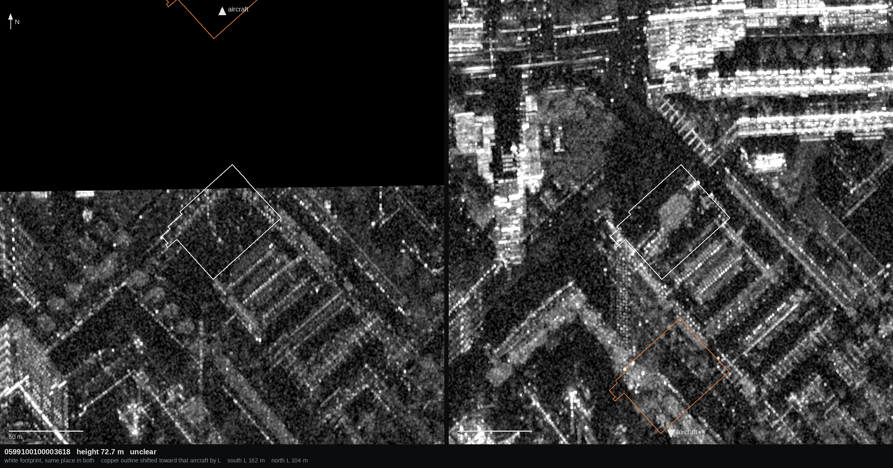
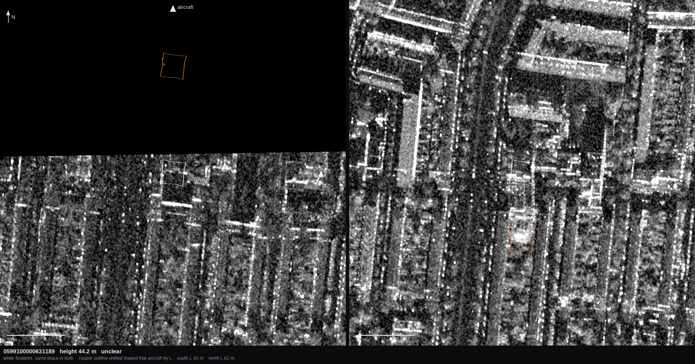
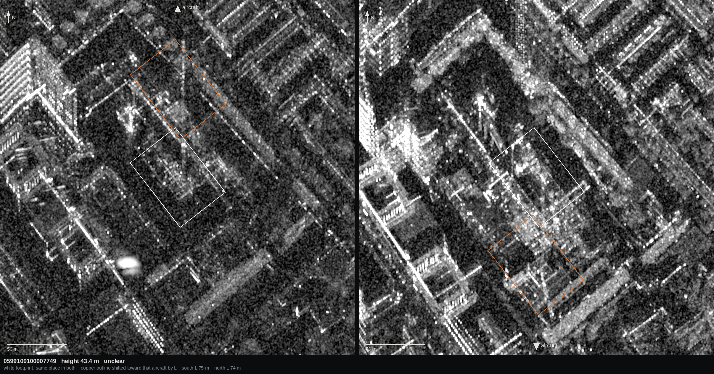
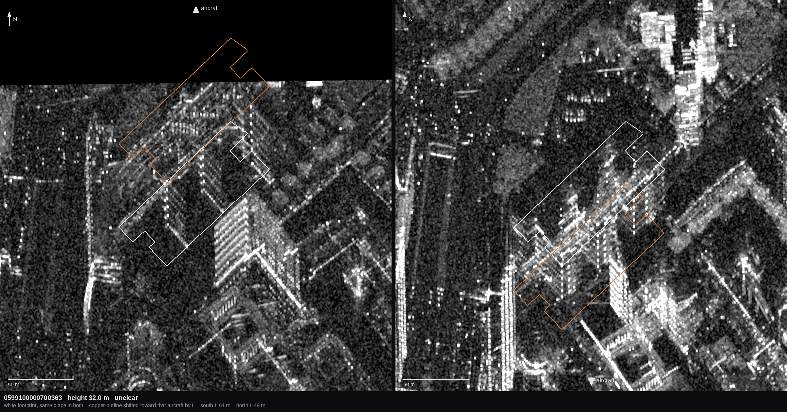
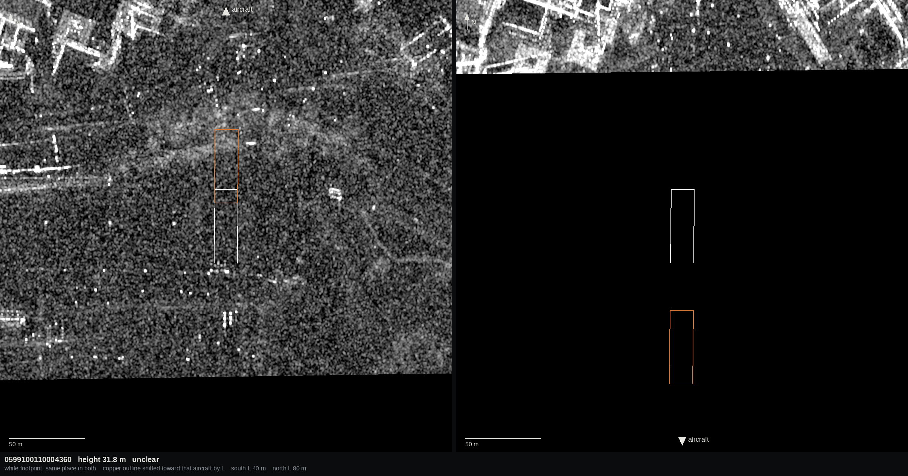
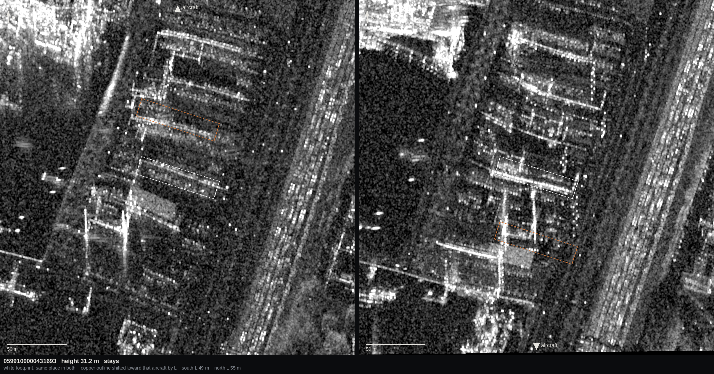

# Opposite looks — the roof is not seen to jump

The same buildings, imaged from the north and from the south. A leaning roof moves toward the aircraft, so between the two passes it jumps by about `L_north + L_south` and the footprint is dark in both. A roof that stays in place is bright on the footprint in both, and only the smear changes side.

No label was used. `image_space.py` was not run. Nothing in a dataset was written.

Kop van Zuid is not in this test. Every south-looking MAG-POL strip in the catalog stops at northing 5749729. Kop van Zuid (`20190823072627_20190823072925`) sits at 5751335–5752097, and the city centre is further north. The only ground imaged from both directions is a band 567 m tall at the port, northing 5749162–5749729, about 14 km east to west. Six roofs in that band stand at least 30 m above the DTM. There are not fifteen. Each building is listed before any count across them.

Look direction is the flight line, perpendicular, on the `collect.radar.pointing` side. The SpaceNet orientation flag is not the look. On these collects it is backwards: flag 0 looks south, flag 1 looks north.

`L` is the near-field length from the near wall, `g - sqrt(g² - 2·H·h + h²)`, toward the track. `g` is the ground range of the near edge. `H` is the platform's ellipsoidal height minus the ground (AHN4 DTM plus NLGEO2018). `h` is the 3DBAG roof (`b3_h_nok`) minus the DTM. Where the DTM is empty inside the footprint, the ground is the median DTM within 20 m of it.

## Pairs

v2 strips only. Opposite means one look is nearer north than south and the other is the other way. Overlap is the intersection of the two MAG-POL bounds. Incidence is the strip's near edge to its far edge.

| south look | north look | overlap km² | width m | height m | incidence, south | incidence, north |
|---|---|---:|---:|---:|---|---|
| `…22074521` 180.18° | `…23065333` 0.46° | 6.70 | 11815 | 567 | 24.4–42.8° | 24.9–42.5° |
| `…22090745` 180.13° | `…23065333` 0.46° | 6.65 | 11724 | 567 | 24.4–42.8° | 24.9–42.5° |
| `…22074521` 180.18° | `…22133635` 0.47° | 6.65 | 11779 | 564 | 24.4–42.8° | 25.0–42.4° |
| `…22090745` 180.13° | `…22133635` 0.47° | 6.53 | 11571 | 564 | 24.4–42.8° | 25.0–42.4° |
| `…23085317` 180.11° | `…23065333` 0.46° | 6.09 | 12656 | 481 | 24.5–42.9° | 24.9–42.5° |
| `…04144102` 180.08° | `…23065333` 0.46° | 5.90 | 10623 | 556 | 24.7–42.0° | 24.9–42.5° |
| `…04144102` 180.08° | `…22133635` 0.47° | 5.87 | 10623 | 552 | 24.7–42.0° | 25.0–42.4° |
| `…23085317` 180.11° | `…22133635` 0.47° | 5.85 | 12225 | 478 | 24.5–42.9° | 25.0–42.4° |
| `…22074521` 180.18° | `…04111453` 359.62° | 5.66 | 10681 | 530 | 24.4–42.8° | 25.2–41.6° |
| `…22090745` 180.13° | `…04111453` 359.62° | 5.58 | 10533 | 530 | 24.4–42.8° | 25.2–41.6° |
| `…04144102` 180.08° | `…04111453` 359.62° | 5.04 | 9735 | 518 | 24.7–42.0° | 25.2–41.6° |
| `…23085317` 180.11° | `…04111453` 359.62° | 4.74 | 10681 | 444 | 24.5–42.9° | 25.2–41.6° |
| `…22074521` 180.18° | `…22134645` 0.43° | 0.22 | 11815 | 18 | 24.4–42.8° | 25.0–42.4° |
| `…22090745` 180.13° | `…22134645` 0.43° | 0.21 | 11624 | 18 | 24.4–42.8° | 25.0–42.4° |
| `…22085445` 180.20° | `…23065333` 0.46° | 0.15 | 12283 | 12 | 24.4–42.9° | 24.9–42.5° |
| `…22085445` 180.20° | `…22133635` 0.47° | 0.11 | 12120 | 9 | 24.4–42.9° | 25.0–42.4° |
| `…04144102` 180.08° | `…22134645` 0.43° | 0.07 | 10623 | 7 | 24.7–42.0° | 25.0–42.4° |

Every pair in the table is that same band. Nothing looking south reaches Kop van Zuid.

The hole is not the orientation flag. Flight lines refit from the state vectors: `…23072925` flag 1 looks 0.46°, and the northernmost flag-0 strip `…22074521` looks 180.18°. The pair used below was refit the same way: south `20190822074237_20190822074521` looks 180.18°, north `20190823065021_20190823065333` looks 0.46°.

That pair is the largest overlap, 6.70 km². It contains every building in the band whose roof is at least 30 m above the DTM. The south strip is on disk. The north strip was read from the public MAG-POL, windows only. Both images were left north-up. They were not flipped. The sensor for the south look is at the north edge. The sensor for the north look is at the south edge.

## Registration

Eight windows of 160 m, spread along the overlap, each with a shoreline and no ground more than 3 m above the DTM. Cross-correlation of HH, smoothed over 21 px (about 5 m), search ±10 m. The shift is the north-look image relative to the south-look image. A peak on the ±10 m stop did not lock.

| window | easting | northing | east m | north m | coefficient |
|---:|---:|---:|---:|---:|---:|
| 0 | 592357 | 5749252 | +7.58 | +8.51 | 0.22 |
| 1 | 593607 | 5749332 | +0.06 | −10.00 | 0.44 |
| 2 | 594357 | 5749332 | −0.28 | +0.04 | 0.44 |
| 3 | 595107 | 5749252 | −0.02 | −10.00 | 0.28 |
| 4 | 595607 | 5749412 | +0.32 | −3.24 | 0.53 |
| 5 | 598357 | 5749252 | −0.75 | +6.59 | 0.12 |
| 6 | 598357 | 5749332 | −0.10 | +5.90 | 0.21 |
| 7 | 600357 | 5749412 | −2.51 | +0.09 | 0.53 |

Median of all eight is −0.06 m east and +0.06 m north, which hides the failures. Windows 1 and 3 sit on the search stop. Along-track, six of the eight are within 1 m east. In range the offsets that lock (windows 2, 4, 7, coefficients 0.44–0.53) are +0.04, −3.24 and +0.09 m. The range shift is not measured to 1 m: a north-looking image and a south-looking image do not share the same bright streaks, so the correlation often has nothing to lock onto. Nothing that did lock is a 100 m misregistration. The building test uses the georeferencing as published.

## Buildings

The band contains 17 footprints with a 3DBAG height of at least 20 m, and 4290 footprints of any height. Six have a roof at least 30 m above the DTM. There are not 15. These are the six, tallest first.

A 300 m crop is centred on the footprint, north up, both looks on the same grey stretch (2nd to 98th percentile of the two crops together). White is the footprint. Copper is that footprint moved toward that image's aircraft by that image's `L`. Black is outside that image. Left is the south look: the aircraft is at the top, and the copper outline is shifted north by `L_south`. Right is the north look: the aircraft is at the bottom, and the copper outline is shifted south by `L_north`. The gif flips the two looks once a second.

Open land is finite DTM, DSM minus DTM under 3 m, and outside every footprint buffered 4 m. Water in this DTM is empty and is not in the median. Footprint pixels are eroded 2 m. Each dB number is the median HH in that region minus the median HH of open land in the same crop.

The call, fixed before looking at the pictures: **stays** if the footprint is at least +1 dB above open land in both looks and at least as bright as the copper outline in both. **Jumps** if the footprint is below open land in both looks and the copper outline is at least +1 dB brighter than the footprint in both. Otherwise **unclear**.

| building | height m | L north m | L south m | footprint dB north | footprint dB south | cyan dB north | cyan dB south | verdict |
|---|---:|---:|---:|---:|---:|---:|---:|---|
| [0599100100003618](01_0599100100003618.png) | 72.7 | 104 | 162 | +0.26 | −0.45 | +1.64 | — | unclear |
| [0599100000631189](02_0599100000631189.png) | 44.2 | 61 | 93 | +3.22 | +0.28 | +4.62 | — | unclear |
| [0599100100007749](03_0599100100007749.png) | 43.4 | 74 | 75 | +1.88 | +0.47 | +1.98 | +1.22 | unclear |
| [0599100000700363](04_0599100000700363.png) | 32.0 | 49 | 64 | +2.86 | +0.21 | +2.91 | +2.06 | unclear |
| [0599100110004360](05_0599100110004360.png) | 31.8 | 80 | 40 | — | −0.60 | — | +0.43 | unclear |
| [0599100000431693](06_0599100000431693.png) | 31.2 | 55 | 49 | +4.87 | +2.45 | +0.11 | +1.68 | stays |

**0599100100003618** — unclear. Footprint +0.26 dB from the north and −0.45 dB from the south, so neither look clears +1 dB, and the south copper outline has no pixels: `L` is 162 m and the south-looking swath ends 39 m north of the roof. Height 72.7 m, ground −0.77 m NAP, area 3037 m². Near-edge ground range 1161 m from the north-looking track (θ 35.6°) and 792 m from the south-looking track (θ 26.0°). In the part of the south look that is imaged, and in the north look, the bright return sits inside the white outline. It is not 162 m north of the footprint.

[Flip](01_0599100100003618.gif)

**0599100000631189** — unclear. Footprint +3.22 dB from the north, only +0.28 dB from the south. The south copper outline is outside the swath (`L` 93 m, the roof is on the north edge). The north copper outline is +4.62 dB, brighter than the footprint, and it lands on the next bright block south of this one, not on a copy of this 380 m² roof. Height 44.2 m, ground −1.10 m NAP. Ground range 1188 m (θ 36.3°) and 810 m (θ 26.5°).

[Flip](02_0599100000631189.gif)

**0599100100007749** — unclear. Footprint +1.88 dB from the north and +0.47 dB from the south. The south median misses +1 dB. The footprint is a large yard, 3347 m², and the bright core is a fraction of it, so the median is pulled down. That core is inside the white outline in both looks. The copper outline is +1.98 and +1.22 dB and does not contain the core. Height 43.4 m, ground −1.31 m NAP. Ground range 975 m (θ 31.0°) and 970 m (θ 30.9°). Both `L` values, 74 m and 75 m, fall inside the crop.

[Flip](03_0599100100007749.gif)

**0599100000700363** — unclear. Footprint +2.86 dB from the north and +0.21 dB from the south. Copper +2.91 and +2.06 dB. `L` (49 m and 64 m) is shorter than this building, area 5070 m², so the shifted outline still covers the bright southern edge and the next block, and the copper median is not a clean test. The bright mass is in the white outline in both looks, not displaced by `L_north + L_south` (113 m). Height 32.0 m, ground −1.17 m NAP. Ground range 1081 m (θ 33.7°) and 838 m (θ 27.3°). The south-looking swath cuts the northern part of the copper outline.

[Flip](04_0599100000700363.gif)

**0599100110004360** — unclear. The north-looking swath ends on this building. The footprint and the copper outline are empty in that image, so there is no north number. From the south the footprint is −0.60 dB and the copper outline is +0.43 dB. Height 31.8 m, ground −0.46 m NAP, area 759 m². Ground range 675 m (θ 22.6°, this is the near edge of the north-looking strip) and 1304 m (θ 38.8°).

[Flip](05_0599100110004360.gif)

**0599100000431693** — stays. Footprint +4.87 dB from the north and +2.45 dB from the south, both above +1 dB and both brighter than the copper outline (+0.11 and +1.68 dB). The bright lines sit in the white rectangle in both looks. The copper rectangle, 55 m south in one look and 49 m north in the other, is the darker gap. Height 31.2 m, ground 3.40 m NAP, area 1050 m². Ground range 932 m (θ 30.0°) and 1048 m (θ 32.9°). The 300 m crop is inside both images.

[Flip](06_0599100000431693.gif)

## After the list

1 stays, 0 jump, 5 unclear, out of 6.

No building has a dark footprint in both looks and a bright copper outline in both. The one building that is inside both swaths, with both leaned positions also inside the images, stays on its footprint. The other five are limited by where the two looks overlap. The tall roofs sit near the north edge of every south-looking strip, so the place a lean would put them, toward that aircraft, falls outside the image. Where a bright return is imaged from both sides, it is on the footprint.

## What this does not change

v4 is unchanged. No tile was rebuilt. Kop van Zuid still has no opposite look, so this test does not re-score the rule B decision on that strip ([DECIDE.md](../../../DECIDE.md)). It says the port roofs that can be seen from both sides are not sitting `L` meters toward the aircraft.
